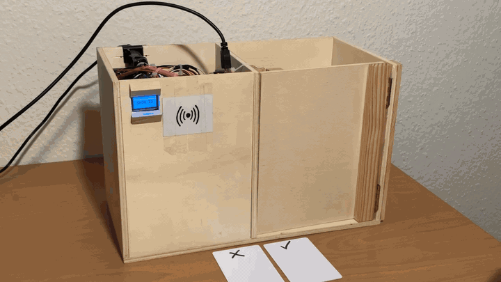
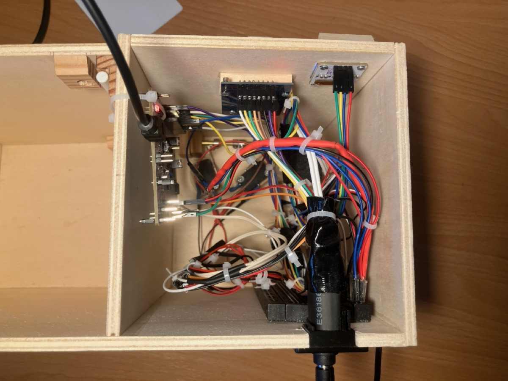

# Access Controller

RFID-based access control on an STM32 microcontroller.

The demonstrator is a small case that is locked with a bolt. It can be unlocked with an authorized RFID card:
if the card's UID matches an entry in the whitelist, an MG90S servo moves the bolt back and the door can be opened.
Two micro switches detect the position of the bolt, a reed contact detects whether the door is open or closed.
An OLED display shows the current state, and status messages are sent over UART.

<p align="center">
  <br>
  <em>Demonstrator: an authorized card unlocks the bolt, the door is opened and closed, and the bolt locks again</em>
</p>

## Features

- reads 4-byte UIDs with a self-written MFRC522 driver (SPI, interrupt-driven) and checks them against a whitelist
- unlocks and locks the bolt with a servo (PWM) and checks the end positions with two sensors
- locks automatically when the door is closed again, or 30 s after unlocking if the door is not opened
- moves the bolt back if the door is opened while locking
- blocks access attempts after 3 unauthorized cards; the block time doubles from 10 s up to 5 min
- shows the state on an SSD1306 OLED with a self-written I²C driver
- detects faults (bolt timeouts, contradictory sensors, RFID errors), stops the servo and reports the cause
- logs state changes, access attempts and errors over UART

## Hardware

- NUCLEO-F446RE (STM32F446RE, Arm Cortex-M4)
- MFRC522 RFID reader and RFID cards
- SSD1306 OLED, 128×64, I²C
- MG90S servo with external 5 V supply
- 2 micro switches (bolt end positions), 1 reed contact (door)

<p align="center">
  <br>
  <em>Electronics compartment with NUCLEO board, RFID reader and wiring</em>
</p>

Pins, wiring and power supply: [docs/hardwarelist.md](docs/hardwarelist.md)

## How it works

The firmware runs bare metal in a superloop; timeouts are checked with stored start times instead of blocking waits.
A state machine in [access_controller.c](firmware/Core/Src/access_controller.c) decides what happens:

```text
LOCKED_READY          ── authorized card ──────▶ UNLOCKING
UNLOCKING             ── bolt unlocked ────────▶ UNLOCKED_DOOR_CLOSED
UNLOCKED_DOOR_CLOSED  ── door opened ──────────▶ UNLOCKED_DOOR_OPEN
UNLOCKED_DOOR_CLOSED  ── 30 s, door closed ────▶ LOCKING
UNLOCKED_DOOR_OPEN    ── door closed ──────────▶ LOCKING
LOCKING               ── bolt locked ──────────▶ LOCKED_READY
LOCKING               ── door opened ──────────▶ UNLOCKING
LOCKED_READY          ── 3 unauthorized cards ─▶ LOCKED_BLOCKED
LOCKED_BLOCKED        ── block time over ──────▶ LOCKED_READY
any state             ── fault ────────────────▶ FAULT (until reset)
```

At startup, the initial state is chosen from the debounced door and bolt sensors.

More details: [docs/architecture.md](docs/architecture.md), [docs/requirements.md](docs/requirements.md), [docs/display_states.md](docs/display_states.md)

## Project structure

| Path | Content |
| --- | --- |
| `firmware/Core/Src`, `firmware/Core/Inc` | own modules: `access_controller`, `rfid`, `oled`, `chars`, `servo`, `sensors`, `uart`, `log` |
| `firmware/Core/Src/main.c` | CubeMX initialization, own code in the `USER CODE` blocks |
| `firmware/Drivers` | ST HAL, CMSIS and board support (not my own code) |
| `firmware/firmware.ioc` | STM32CubeMX configuration |
| `docs/` | requirements, architecture, hardware, display states, code style, state diagram, images |
| `milestones.md` | development steps |

The application logic and the device drivers for the RFID reader and the display are my own code.
Clock, pin and peripheral initialization is generated by STM32CubeMX; the STM32 peripherals are used through the ST HAL.

## Build and flash

Requirements: CMake ≥ 3.22, Ninja and the GNU Arm toolchain (`arm-none-eabi-gcc`), e.g. from the STM32Cube bundles.

From the `firmware/` folder:

```sh
cmake --preset Debug
cmake --build --preset Debug
```

The firmware is written to `firmware/build/Debug/firmware.elf`. Use `Release` instead of `Debug` for an optimized build.

Flashing over the onboard ST-LINK:

```sh
STM32_Programmer_CLI -c port=SWD -w build/Debug/firmware.elf -v -rst
```

In VS Code, the project can also be built with the CMake Tools extension and debugged with Cortex-Debug (`.vscode/launch.json`).

## UART diagnostics

Status and error messages are available through the ST-LINK virtual COM port. Use a serial terminal with these settings:

- Baud rate: 115200
- Format: 8N1
- Flow control: none

Connect first, then reset the board to see the startup messages.

Example output:

```text
[12 ms] INFO OLED: Init successful
[14 ms] INFO RFID: Init successful
[520 ms] INFO SENSOR: Door closed
[521 ms] INFO CTRL: New state LOCKED_READY
[8410 ms] INFO RFID: Valid UID detected E7 20 75 33
[8411 ms] INFO CTRL: New state UNLOCKING
```

### Example: macOS with screen

Find the device and connect using its actual path:

```bash
ls /dev/cu.usbmodem*
screen /dev/cu.usbmodem1303 115200
```

To quit, press Ctrl+A, release, then press `\`. Confirm if prompted.

To manage an existing session:

```bash
screen -ls
screen -r SESSION_ID
screen -S SESSION_ID -X quit
```

Replace SESSION_ID with the identifier from `screen -ls`. The last command terminates the session and releases the port.

On other operating systems, use a serial terminal with the settings above. These instructions were tested on macOS.

## Testing

The firmware was tested manually on the hardware, using the UART log and the display.
The test cases and their results are listed in [docs/requirements.md](docs/requirements.md), section 8.
There are no automated tests.

## Known limitations

- The UID is not a secure authentication: it is transmitted unencrypted and can be copied. The system is not protected against manipulation.
- Only 4-byte UIDs are supported (cascade level 1). Cards with 7- or 10-byte UIDs are not recognized.
- A card that stays at the reader is read again every 100 ms and counts as a new access attempt.
- Error flags reported by the MFRC522 itself (CRC, collision, parity) are not evaluated.
- FAULT can only be left by a reset. The servo is stopped and the bolt stays where it is.
- The reader is not re-initialized automatically after a communication error.
- UIDs are logged in plain text for debugging.
- A broken door sensor wire reads as "door open" (pull-up, contact to GND). The system then does not lock the door.
- A display update with text blocks the main loop for about 0.1 s (estimated, I²C at 100 kHz).
- No alarm sound when the door stays open too long.
- Some planned display texts are not implemented (see [docs/display_states.md](docs/display_states.md)).

## Project goals and learning path

The main goal of this project was to grow my own understanding of embedded software development.

I had no prior experience with software projects on the microcontroller level.
I did one Raspberry Pi project before, but with its own operating system there is limited overlap.
All my other project experience is in application software development.

For that reason I tried to combine multiple concepts and communication standards that are widely used in microcontroller development:

- C
- STM32 microcontroller development
- GPIO
- timers
- interrupts
- UART (debugging via USB)
- SPI (communication between STM32 and RFID reader)
- I²C (communication between STM32 and OLED)
- PWM (servo control)
- debugging
- state machine
- error handling
- manual testing on hardware
- documentation
- reading datasheets
- basic driver development (RFID reader, OLED)

It definitely helped that I had my introduction to programming in C/C++ at university.
I repeated the main concepts and syntax and learned how bit operations are used in C to have a proper base.

Afterwards I set up the board and the firmware project.
I use GCC as compiler, GDB as debugger, CMake for the build configuration and Ninja to run the build, with VS Code as editor.
For the initial project setup and configuration I used STM32CubeMX.
Then I made myself familiar with the structure of the STM32F446RE and the basics of embedded systems, such as GPIOs, clocks and buses.
I used the official documents from STMicroelectronics to also learn how to work with this kind of documentation.

Before the access controller itself, I worked through smaller exercises: GPIO polling and interrupts with debouncing, UART and SPI register access without HAL, and a UART ring buffer.
The exercise code is preserved at the tag [`learning-exercises`](https://github.com/NilsL1234/access-controller/tree/learning-exercises) in `firmware/Core/Src/main.c`.
The development steps are described in [milestones.md](milestones.md).

### Use of AI

I used AI mainly to learn. For each topic, the AI explained the concepts and I asked questions until I understood them. Then I did small exercises on my own to practise.

I developed the firmware logic and the drivers myself. I only asked the AI for help when I could not find a bug on my own. The exception is the character bitmaps for the OLED, which were a repetitive task after I had done the first characters myself.

At the end, when the system was already working, I used an AI agent for code reviews, cleanup and drafting the documentation, which I reviewed and corrected. This was also a way to gain more experience working with AI agents in a real project.

## License

My own code is licensed under the [MIT License](LICENSE).
Files generated by STM32CubeMX and the ST drivers in `firmware/Drivers` are subject to their own licenses.
